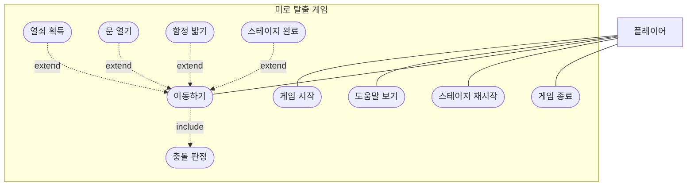
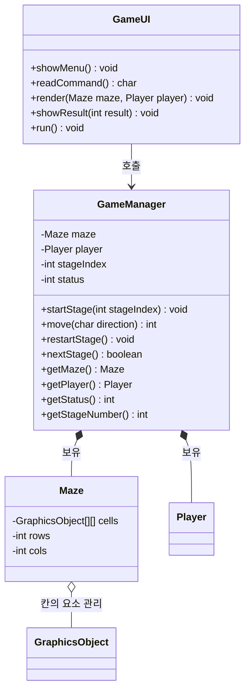
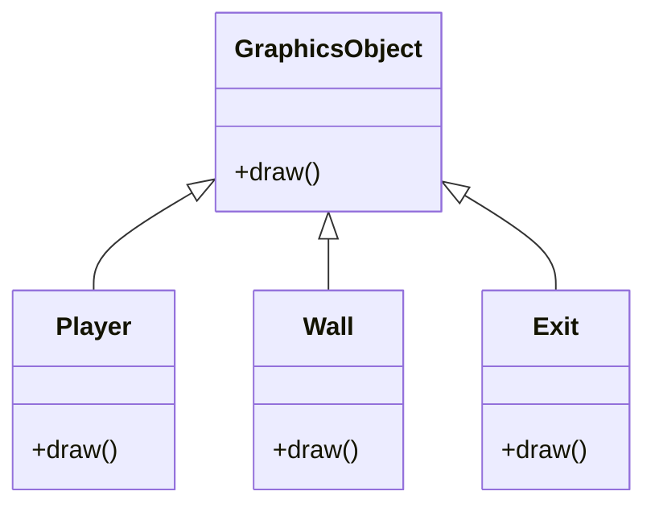
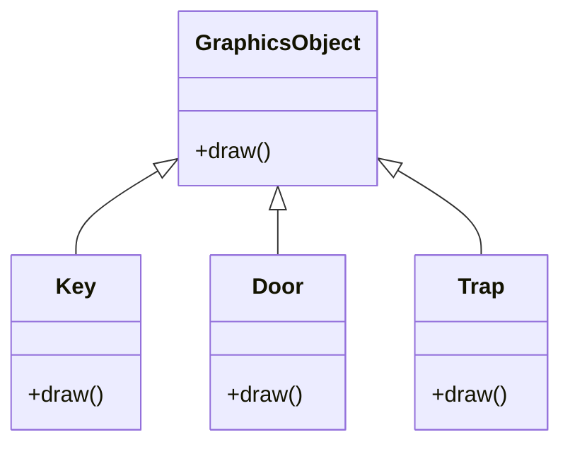

# 미로 탈출 게임 작업 명세서

이 문서는 Java 기반 텍스트 미로 탈출 게임의 요구사항을 정의한 작업 명세서(SRS) v1.0이다. 프로젝트 제안서를 바탕으로 작성했으며, 개발 중 변경되는 내용은 개정 이력에 기록한다.

## 문서 정보

| 항목 | 내용 |
| --- | --- |
| 프로젝트명 | 미로 탈출 게임 |
| 문서 버전 | v1.0 |
| 작성자 | 유다미(2023247006), 유예인(2023247045) |
| 개발 언어 | Java |

## 목차

1. [개요](#1-개요)
2. [전체 설명](#2-전체-설명)
3. [기능 요구사항](#3-기능-요구사항)
4. [비기능 요구사항](#4-비기능-요구사항)
5. [데이터 규격 정의](#5-데이터-규격-정의)
6. [핵심 인터페이스 규약](#6-핵심-인터페이스-규약)
7. [유스케이스 다이어그램 및 명세](#7-유스케이스-다이어그램-및-명세)
8. [클래스 다이어그램 및 설명](#8-클래스-다이어그램-및-설명)
9. [역할 분담 개발 계획 및 테스트 계획](#9-역할-분담-개발-계획-및-테스트-계획)
10. [개정 이력](#개정-이력)

## 1. 개요

### 1-1. 목적

팀원 두 명이 같은 기준으로 구현하고 테스트할 수 있도록 게임의 기능·데이터·인터페이스를 정의한다. Front end와 Back end를 따로 개발한 뒤 통합하므로, 두 부분이 주고받는 규약을 명확히 한다.

### 1-2. 범위

수업에서 제공된 `GraphicsObject.java`를 활용해 미로와 게임 요소를 표시하고, 사용자가 이동 명령을 입력해 출구를 찾는 게임을 만든다.

- 미로 및 상태 출력, W/A/S/D 이동, 벽 충돌 판정
- 열쇠 획득과 문 열기, 함정과 체력 관리
- 3개 스테이지 진행, 이동 횟수 기록, 재시작 및 종료

### 1-3. 용어 정의

| 용어 | 의미 |
| --- | --- |
| 스테이지 | 미리 준비된 미로 하나. 총 3개를 순서대로 진행한다. |
| 칸(Cell) | 미로를 이루는 한 단위 좌표. 하나의 게임 요소가 놓인다. |
| 게임 요소 | 벽, 통로, 플레이어, 출구, 열쇠, 문, 함정 |
| 이동 횟수 | 실제로 한 칸 이동에 성공한 횟수 |
| 게임 오버 | 체력이 0이 된 상태 |
| 최종 승리 | 마지막인 3번째 스테이지의 출구에 도착한 상태 |

## 2. 전체 설명

### 2-1. 제품 개요

플레이어는 열쇠를 얻어 잠긴 문을 열고, 함정을 피해 출구에 도착해야 한다. 수업에서 다룬 단순한 도형 출력을 확장해 사용자 입력에 따른 이동, 충돌 판정, 아이템 획득, 체력 관리, 스테이지 진행을 구현한다.

프로그램은 두 부분으로 나뉜다.

| 구분 | 역할 |
| --- | --- |
| Front end | 콘솔 화면 출력과 사용자 입력 처리 |
| Back end | 게임 규칙 적용과 게임 상태 관리 |

### 2-2. 사용자

사용자는 플레이어 한 명이다. 키보드로 메뉴를 고르고 이동 명령을 입력하며, 별도 관리자 기능은 없다.

### 2-3. 운영 환경

| 항목 | 내용 |
| --- | --- |
| 언어 | Java |
| 실행 방식 | 콘솔(텍스트) 기반 |
| 입력 장치 | 키보드 |
| 소스 관리 | GitHub.com |

### 2-4. 제약 사항

- 수업에서 제공된 `GraphicsObject.java`의 좌표와 그리기 기능을 바탕으로 설계한다.
- 미로는 미리 준비된 3개 스테이지를 사용한다.
- 최종 소스 코드와 사용 설명서(`README.md`)를 GitHub.com에 커밋한다.

## 3. 기능 요구사항

게임은 아래 8개 기능을 갖는다. ‘단계’는 개발 계획의 기본 기능과 확장 기능 구분을 따른다.

| ID | 기능 | 요구 내용 | 단계 | 담당 |
| --- | --- | --- | --- | --- |
| FR-01 | 미로 및 상태 출력 | 벽, 통로, 플레이어, 출구, 열쇠, 문, 함정을 문자로 구분해 표시한다. 현재 체력, 보유 열쇠 수, 이동 횟수도 출력한다. | 기본 | Front |
| FR-02 | 플레이어 이동 | W/A/S/D로 상하좌우 한 칸씩 이동한다. 잘못된 명령은 안내 후 다시 입력받는다. | 기본 | Front(입력) / Back(이동) |
| FR-03 | 충돌 판정 | 벽이나 미로 범위 밖으로 이동하지 못한다. 차단되면 위치와 이동 횟수를 유지한다. | 기본 | Back |
| FR-04 | 열쇠 획득 및 문 열기 | 열쇠 칸에 도착하면 열쇠를 얻고 해당 칸은 통로가 된다. 잠긴 문은 열쇠 1개를 사용해 열며, 열린 문은 계속 통과할 수 있다. | 확장 | Back |
| FR-05 | 함정 및 체력 관리 | 초기 체력은 100이다. 함정에 들어갈 때마다 체력이 20 감소하고, 0이 되면 게임 오버다. | 확장 | Back |
| FR-06 | 탈출 및 스테이지 진행 | 출구에 도착하면 스테이지를 완료한다. 3개 스테이지를 순서대로 진행하고, 마지막 출구에 도착하면 최종 승리다. | 기본(탈출) / 확장(스테이지 전환) | Back |
| FR-07 | 이동 횟수 기록 | 실제로 한 칸 이동했을 때만 횟수를 늘리고, 스테이지 완료 시 이동 횟수를 표시한다. | 기본 | Back(계산) / Front(표시) |
| FR-08 | 재시작 및 종료 | 현재 스테이지를 초기 상태로 다시 시작하거나 게임을 종료한다. 새 스테이지와 재시작 시 체력·열쇠·이동 횟수를 초기화한다. | 확장 | Back(초기화) / Front(메뉴) |

이 밖에 Front end는 게임 시작·도움말·종료 메뉴와 성공·실패 메시지를 제공한다.

## 4. 비기능 요구사항

| ID | 분류 | 요구 내용 |
| --- | --- | --- |
| NFR-01 | 유지보수성 | 게임 요소의 공통 기능은 `GraphicsObject` 상속으로 재사용하고, 요소별 표시 방법은 오버라이딩으로 구현한다. |
| NFR-02 | 캡슐화 | 체력, 위치 등 게임 데이터는 직접 바꾸지 않고 메서드를 통해서만 변경한다. |
| NFR-03 | 모듈 분리 | Front end는 화면과 입력만, Back end는 규칙과 상태만 담당하며, 6장의 인터페이스로만 주고받는다. |
| NFR-04 | 안정성 | 잘못된 입력을 받아도 프로그램이 종료되지 않고 안내 후 다시 입력받는다. |
| NFR-05 | 사용성 | 매 입력마다 미로와 체력·열쇠·이동 횟수를 다시 출력해 플레이어가 현재 상태를 항상 알 수 있게 한다. |
| NFR-06 | 검증 가능성 | 3개 스테이지는 모두 실제로 탈출 가능해야 한다. |

## 5. 데이터 규격 정의

미로는 문자 하나가 칸 하나를 나타내는 2차원 격자로 저장한다. 좌표는 왼쪽 위를 `(0, 0)`으로 하는 **(행, 열)**이다. 아래 표시 문자와 값은 v1.0 기준이며, 공통 설계 단계에서 확정한다.

### 5-1. 맵 표시 문자

| 문자 | 게임 요소 | 통과 여부 | 도착 시 처리 |
| --- | --- | --- | --- |
| `#` | 벽 | 불가 | 이동 차단, 위치·이동 횟수 유지 |
| `.` | 통로 | 가능 | 없음 |
| `P` | 플레이어 | — | 현재 위치 표시 |
| `E` | 출구 | 가능 | 스테이지 완료 |
| `K` | 열쇠 | 가능 | 열쇠 +1, 해당 칸은 통로로 변경 |
| `D` | 잠긴 문 | 열쇠 보유 시 가능 | 열쇠 -1, 열린 문으로 변경 |
| `O` | 열린 문 | 가능 | 없음 |
| `T` | 함정 | 가능 | 체력 -20 |

### 5-2. 게임 상태 데이터

| 데이터 | 자료형 | 초깃값 | 범위 및 규칙 |
| --- | --- | --- | --- |
| 체력(`hp`) | `int` | `100` | 0~100. 함정마다 20 감소하고, 0이면 게임 오버 |
| 보유 열쇠 수(`keys`) | `int` | `0` | 0 이상 |
| 이동 횟수(`moves`) | `int` | `0` | 실제 이동 성공 시에만 +1 |
| 플레이어 위치(`row`, `col`) | `int` | 스테이지 시작 위치 | 미로 범위 안 |
| 현재 스테이지(`stageIndex`) | `int` | `0` | 0~2 |
| 게임 상태(`status`) | `int` 상수 | `STATUS_PLAYING` | 아래 상태 상수 사용 |

| 상태 상수 | 값 | 의미 |
| --- | --- | --- |
| `STATUS_PLAYING` | `0` | 게임 진행 중 |
| `STATUS_STAGE_CLEAR` | `1` | 스테이지 완료 |
| `STATUS_GAME_OVER` | `2` | 게임 오버 |
| `STATUS_VICTORY` | `3` | 최종 승리 |

체력·열쇠·이동 횟수는 새 스테이지를 시작하거나 재시작할 때 초깃값으로 돌아간다.

### 5-3. 스테이지 데이터

각 스테이지는 문자열 배열(`String[]`)로 코드에 미리 저장한다. 플레이어 시작 위치는 `P`, 출구는 `E`로 스테이지마다 하나씩 두며, 실제 3개 맵은 공동 작업으로 구성한다.

아래는 형식 예시다.

```text
#########
#P..#.#E#
#.#.#.#.#
#.#K..#D#
#...T...#
#########
```

맵 크기를 고정할지 스테이지별로 다르게 할지는 공통 설계에서 확정한다.

## 6. 핵심 인터페이스 규약

Front end와 Back end는 `GameManager`의 공개 메서드로만 연결된다. 한 번의 입력은 다음 순서로 처리한다.

1. `GameUI`가 명령을 입력받고 형식을 검사한다. 잘못된 명령이면 안내 후 다시 입력받는다.
2. 올바른 명령이면 `GameManager`에 전달한다.
3. `GameManager`가 규칙에 따라 상태를 바꾸고 처리 결과(`MoveResult`)를 반환한다.
4. `GameUI`가 결과 메시지를 출력하고 미로와 상태를 다시 그린다.

### 6-1. 입력 명령

| 입력 | 의미 |
| --- | --- |
| `1` / `2` / `3` | 게임 시작 / 도움말 / 종료 |
| `W` / `A` / `S` / `D` | 위 / 왼쪽 / 아래 / 오른쪽으로 한 칸 이동 |
| `R` | 현재 스테이지 재시작 |
| `Q` | 게임 종료 |

대소문자는 구분하지 않는다.

### 6-2. Back end 제공 메서드: GameManager

| 메서드 | 반환 | 설명 |
| --- | --- | --- |
| `startStage(int stageIndex)` | `void` | 해당 스테이지를 불러오고 체력·열쇠·이동 횟수를 초기화한다. |
| `move(char direction)` | `int` | W/A/S/D 한 칸 이동을 처리하고 결과를 반환한다. |
| `restartStage()` | `void` | 현재 스테이지를 처음 상태로 되돌린다. |
| `nextStage()` | `boolean` | 다음 스테이지로 넘어간다. 마지막 스테이지였으면 `false`를 반환한다. |
| `getMaze()` | `Maze` | 화면에 그릴 현재 미로를 반환한다. |
| `getPlayer()` | `Player` | 체력·열쇠 수·이동 횟수를 읽을 플레이어를 반환한다. |
| `getStatus()` | `int` | 진행 중, 스테이지 완료, 게임 오버, 최종 승리 중 하나의 상태 상수를 반환한다. |
| `getStageNumber()` | `int` | 현재 스테이지 번호(1~3)를 반환한다. |

### 6-3. 처리 결과: MoveResult 상수

처리 결과는 `GameManager` 클래스에 `public static final int` 상수로 정의하며, `move()` 메서드가 이 값 중 하나를 반환한다. `MoveResult`는 처리 결과를 설명하는 명칭이며 별도 클래스로 정의하지 않는다.

| 상숫값 | 이름 | 의미 | 위치·이동 횟수 |
| --- | --- | --- | --- |
| `0` | `MOVED` | 통로로 이동 | 변경 |
| `1` | `BLOCKED_WALL` | 벽에 막힘 | 유지 |
| `2` | `BLOCKED_OUT_OF_RANGE` | 미로 범위 밖 | 유지 |
| `3` | `BLOCKED_LOCKED_DOOR` | 열쇠 없이 잠긴 문에 막힘 | 유지 |
| `4` | `KEY_ACQUIRED` | 이동하며 열쇠 획득 | 변경 |
| `5` | `DOOR_OPENED` | 열쇠를 사용해 문을 열고 이동 | 변경 |
| `6` | `TRAP_HIT` | 함정에 들어가 체력 20 감소 | 변경 |
| `7` | `STAGE_CLEAR` | 출구 도착 | 변경 |
| `8` | `GAME_OVER` | 체력이 0이 됨 | 변경 |
| `9` | `VICTORY` | 마지막 스테이지 출구 도착 | 변경 |

### 6-4. Front end 메서드: GameUI

| 메서드 | 설명 |
| --- | --- |
| `showMenu()` | 시작·도움말·종료 메뉴를 출력한다. |
| `readCommand()` | 명령을 입력받고 형식을 검사해 올바른 명령만 반환한다. |
| `render(Maze, Player)` | 미로와 체력·열쇠·이동 횟수를 출력한다. |
| `showResult(int)` | 결과에 맞는 안내·성공·실패 메시지를 출력한다. |
| `run()` | 메뉴와 게임 루프를 실행한다. |

## 7. 유스케이스 다이어그램 및 명세

원본의 유스케이스 관계를 Mermaid 흐름도로 표현한다. `include`는 이동 시 항상 수행하는 충돌 판정, `extend`는 도착한 칸에 따라 발생하는 동작을 나타낸다.



플레이어는 게임 시작, 도움말 보기, 이동하기, 스테이지 재시작, 게임 종료 기능을 직접 사용한다. 이동하기는 항상 충돌 판정을 포함하고, 도착한 칸에 따라 열쇠 획득, 문 열기, 함정 밟기, 스테이지 완료로 확장한다.

### 7-1. 유스케이스 명세

| ID | 유스케이스 | 사전 조건 | 기본 흐름 | 대안 흐름 |
| --- | --- | --- | --- | --- |
| UC-01 | 게임 시작 | 메인 메뉴 화면 | `1` 입력 → 스테이지 1을 불러오고 체력 100, 열쇠 0, 이동 횟수 0으로 시작 → 미로 출력 | 잘못된 입력이면 안내 후 다시 입력 |
| UC-02 | 도움말 보기 | 메인 메뉴 화면 | `2` 입력 → 조작법과 표시 문자 설명 출력 → 메뉴로 복귀 | — |
| UC-03 | 이동하기 | 게임 진행 중(`PLAYING`) | W/A/S/D 입력 → 충돌 판정 → 한 칸 이동, 이동 횟수 +1 → 도착한 칸 처리 → 화면 갱신 | 벽·범위 밖·잠긴 문(열쇠 없음)이면 이동하지 않고 안내 |
| UC-04 | 열쇠 획득 | 열쇠 칸에 도착 | 열쇠 +1 → 해당 칸을 통로로 변경 | — |
| UC-05 | 문 열기 | 잠긴 문으로 이동, 열쇠 1개 이상 | 열쇠 -1 → 문을 열린 문으로 변경 → 이동 | — |
| UC-06 | 함정 밟기 | 함정 칸에 도착 | 체력 -20 → 체력 표시 갱신 | 체력이 0이면 게임 오버 메시지, 재시작 또는 종료 선택 |
| UC-07 | 스테이지 완료 | 출구 칸에 도착 | 완료 메시지와 이동 횟수 출력 → 다음 스테이지 시작(상태 초기화) | 스테이지 3이면 최종 승리 메시지 |
| UC-08 | 스테이지 재시작 | 게임 화면 | `R` 입력 → 현재 스테이지를 처음 상태로 되돌리고 체력·열쇠·이동 횟수 초기화 | — |
| UC-09 | 게임 종료 | 메뉴 또는 게임 화면 | `3`(메뉴) 또는 `Q` 입력 → 프로그램 종료 | — |

충돌 판정은 UC-03의 내부 단계로, 별도 명세 없이 6-3의 `BLOCKED_*` 결과로 정의한다.

## 8. 클래스 다이어그램 및 설명

총 10개의 클래스로 구성한다. 원본 PDF의 클래스 그림은 하단이 잘려 있으므로, 아래 다이어그램은 확인 가능한 인터페이스와 본문에 명시된 관계를 기준으로 재구성했다. 가독성을 위해 관리 관계와 상속 관계를 나누어 표시한다.

### 관리 관계



### 상속 관계

각 게임 요소는 `GraphicsObject`를 상속하고 `draw()`를 오버라이딩한다. 아래 두 그림의 `GraphicsObject`는 같은 클래스다.





`GameUI`는 `GameManager`만 호출하고, `GameManager`는 `Maze`와 `Player`를 가진다. `Maze`는 각 칸의 `GraphicsObject`를 모아 두고, 플레이어를 포함한 6개 게임 요소는 `GraphicsObject`를 상속해 `draw()`를 오버라이딩한다.

### 8-1. 클래스 설명

| 클래스 | 담당 | 책임 |
| --- | --- | --- |
| `GraphicsObject` | 공동 | 게임 요소의 위치와 화면 표시에 관한 공통 기능. 수업에서 제공된 클래스를 바탕으로 한다. |
| `Player` | Back(상태) / Front(draw) | 체력, 열쇠 수, 이동 횟수를 가지며 메서드로만 변경한다. |
| `Wall`, `Exit`, `Key` | Front(draw) | 각 요소의 표시 방법을 구현한다. |
| `Door` | Back(상태) / Front(draw) | 열림 여부를 가지며, 열리면 계속 통과할 수 있다. |
| `Trap` | Back(상태) / Front(draw) | 도착한 플레이어의 체력을 20 줄인다. |
| `Maze` | Back | 스테이지별 맵과 각 칸에 배치된 요소를 관리한다. 통로는 빈 칸으로 둔다. |
| `GameManager` | Back | 이동, 충돌, 아이템 획득, 체력 감소, 승패 및 스테이지 전환을 처리한다. |
| `GameUI` | Front | 메뉴와 게임 화면을 출력하고 사용자 입력을 받는다. |

게임 상태와 처리 결과는 `GameManager`에 정의한 `int` 상수로 나타낸다(5-2, 6-3 참고).

## 9. 역할 분담 개발 계획 및 테스트 계획

### 9-1. 역할 분담

| 담당 | 구현 내용 | 관련 요구사항 |
| --- | --- | --- |
| Front end — 유예인 | 게임 시작·도움말·종료 메뉴, 게임 요소의 그리기 메서드, 미로 화면 출력, 이동 명령 입력 및 형식 검사, 체력·열쇠·이동 횟수 표시, 성공·실패 메시지 | FR-01, FR-02(입력), FR-07(표시), FR-08(메뉴) |
| Back end — 유다미 | 맵 데이터 관리, 이동 및 충돌 판정, 열쇠 획득과 문 열기, 함정과 체력 처리, 이동 횟수 계산, 탈출·게임 오버 판정, 스테이지 전환 및 재시작 | FR-02(이동)~FR-08 |
| 공동 | 클래스와 메서드 정의, 3개 스테이지 구성, 코드 통합, 테스트, 보고서 작성 및 발표 | 전체 |

### 9-2. 개발 계획

1. **공통 설계:** 좌표 기준, 맵 크기, 표시 문자, 클래스 간 메서드를 정한다.
2. **기본 기능:** 한 개의 맵에서 화면 출력, 이동, 벽 충돌, 탈출을 구현한다. (FR-01, FR-02, FR-03, FR-06, FR-07)
3. **확장 기능:** 열쇠와 문, 함정과 체력, 재시작, 스테이지 전환을 추가한다. (FR-04, FR-05, FR-06, FR-08)
4. **통합 테스트:** 9-3의 테스트 항목을 확인한다.
5. **발표 준비:** 각 스테이지가 실제로 탈출 가능한지 확인하고 주요 기능을 시연한다.

### 9-3. 테스트 계획

| ID | 상황 | 기대 결과 | 관련 요구사항 |
| --- | --- | --- | --- |
| TC-01 | 벽 방향으로 이동 | `BLOCKED_WALL`, 위치·이동 횟수 유지 | FR-03 |
| TC-02 | 미로 가장자리 밖으로 이동 | `BLOCKED_OUT_OF_RANGE`, 위치·이동 횟수 유지 | FR-03 |
| TC-03 | W/A/S/D/R/Q 이외의 입력 | 안내 후 다시 입력, 상태 변화 없음 | FR-02 |
| TC-04 | 열쇠 없이 문에 접근 | `BLOCKED_LOCKED_DOOR`, 위치 유지 | FR-04 |
| TC-05 | 열쇠를 얻은 뒤 문에 접근 | `DOOR_OPENED`, 열쇠 1 감소, 이후 문 계속 통과 가능 | FR-04 |
| TC-06 | 함정에 들어감 | `TRAP_HIT`, 체력 20 감소 | FR-05 |
| TC-07 | 체력이 0이 됨 | `GAME_OVER` | FR-05 |
| TC-08 | 스테이지 1·2 출구 도착 | `STAGE_CLEAR`, 이동 횟수 표시, 다음 스테이지 시작 | FR-06, FR-07 |
| TC-09 | 스테이지 3 출구 도착 | `VICTORY` | FR-06 |
| TC-10 | 재시작 후 상태 확인 | 맵과 체력·열쇠·이동 횟수가 초깃값 | FR-08 |

## 개정 이력

> 원문에서 언급한 개정 이력의 기록란을 추가했다. Markdown 변환은 요구사항 버전을 변경하지 않는다.

| 버전 | 변경 내용 |
| --- | --- |
| v1.0 | 프로젝트 제안서를 바탕으로 작업 명세서 작성 |
| v1.0 (Markdown) | 제목·표·코드 블록 정리, 다이어그램을 Mermaid로 재구성, 명확한 오타 수정(`STATUS_GAME_OVER`, 열쇠, 충돌 판정) |
